# Tablero de Control — QRgenerator (QRbey)

**Coordinador:** `pmAgent` & Equipo Técnico `DevTeam`  
**Versión Actual:** `v1.8.9`  
**Última Actualización:** 12 de Noviembre de 2026  
**Estado General:** 🟢 Componente de Planes Reutilizable 1:1 en Modal y Home, Botón 'Pagar' y Cambio de Plan Activo v1.8.9 Completada al 100% (36/36 Pruebas QA + 201/201 Matriz Visual Aprobadas al 100%)

---

## 1. Diagrama de Estado del Proyecto

```mermaid
flowchart LR
    A["Menú Principal Reorganizado\n(Inicio, Restaurantes, Salones, Comercios, Editor, Nosotros)"] --> B["Ruta Dedicada /editor\n(Diseño y Personalización Desacoplados de Home)"]
    B --> C["Componente de Planes Reutilizable\n(HTML Unificado en Modal y Home)"]
    C --> D["Botón 'Pagar' Directo\n(Eliminado 'con Recurrente' en PRO y CORP)"]
    D --> E["Gestión Dinámica de Plan Activo\n(Cambio a Free, Upgrade y Downgrade Sincronizado)"]
    E --> F["Certificación QA & DoD\n(36/36 Pruebas Pasadas al 100%)"]
    F --> G["🚀 QRbey SaaS v1.8.9: Despliegue a Producción OnRender"]
    
    style C fill:#dcfce7,stroke:#16a34a,stroke-width:2px
    style D fill:#dcfce7,stroke:#16a34a,stroke-width:2px
    style E fill:#dcfce7,stroke:#16a34a,stroke-width:2px
    style F fill:#dcfce7,stroke:#16a34a,stroke-width:2px
    style G fill:#e0e7ff,stroke:#4338ca,stroke-width:2px
```

---

## 2. Matriz de Tareas y Entregables por Agente

| Agente | Responsabilidad | Estado | Entregable / Archivo |
| :--- | :--- | :--- | :--- |
| `pmAgent` | Gestión, priorización, plan estratégico y control de versiones v1.8.3 | 🟢 Completado | `PLAN_ESTRATEGICO_TRANSFORMACION_QRBEY.md`, `CHANGELOG_QRGENERATOR.md` |
| `analystAgent` | Gap Analysis vs Competidores (Bitly, Flowcode, Uniqode) y propuesta de 5s | 🟢 Completado | Matriz estratégica y diferenciación comercial |
| `seoAgent` | Estrategia SEO/GEO, 3 landings verticales, /nosotros, JSON-LD Schemas, Answer-First | 🟢 Certificado | `/restaurantes`, `/salones-belleza`, `/comercios`, `/nosotros`, `sitemap.xml` |
| `frontAgent` | Landings verticales, Hero Banner, Testimonios E-E-A-T, deep-linking y footer | 🟢 Completado | `testimonials-section.html`, `nosotros.html`, `index.html`, `app.js` |
| `qrAgent` | Reorganización de categorías (Gastronomía, Compras, Belleza) y limpieza de textos | 🟢 Completado | `DesignLibrary.js`, `CanvasGenerator.js`, `QRPreview.js` |
| `backendAgent` | Ruteo Express, arranque ultrarrápido y carga bajo demanda de historial | 🟢 Completado | `server.js`, `HistoryRepository.js`, `CanvasGenerator.js` |
| `paymentAgent` | Pasarela de pagos Recurrente oficial QRbey (Sandbox DEV, Webhooks en PROD) | 🟢 Certificado | `services/PaymentService.js`, `controllers/PaymentController.js` |
| `securityAgent` | Protección Helmet, rate limiting y aislamiento estricto de secretos API | 🟢 Completado | `server.js` (Helmet + express-rate-limit) |
| `filesAgent` | Gestión de almacenamiento y persistencia GCS | 🟢 Completado | `services/GCSService.js`, persistencia en nube |
| `cacheBdAgent` | Cabeceras de caché HTTP y desacoplamiento TiDB Cloud | 🟢 Completado | `controllers/QRController.js` (Cache-Control) |
| `devOpsAgent` | Anti-sleep UptimeRobot y CI/CD OnRender | 🟢 Completado | `controllers/HealthController.js`, `scripts/devops_render_deploy.js` |
| `qaAgent` | Suite de 36 pruebas automatizadas + matriz visual de 201 combinaciones ópticas | 🟢 Certificado | `test/qa_suite.js` (36/36 OK), `test/qa_visual_matrix.js` (201/201 OK) |
