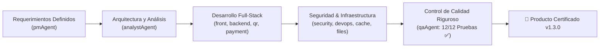

# Tablero de Control — QRgenerator (QRbey)

**Coordinador:** `pmAgent` & Equipo Técnico `DevTeam`  
**Versión Actual:** `v1.3.0`  
**Última Actualización:** 11 de Noviembre de 2026  
**Estado General:** 🟢 Listo para Despliegue y Comercialización (12/12 Pruebas QA Aprobadas)

---

## 1. Diagrama de Estado del Proyecto

---

## 2. Matriz de Tareas y Entregables por Agente

| Agente | Responsabilidad | Estado | Entregable / Archivo |
| :--- | :--- | :--- | :--- |
| `pmAgent` | Gestión, priorización, control de versiones | 🟢 Completado | `PROJECT_STATUS_QRGENERATOR.md`, `CHANGELOG_QRGENERATOR.md` |
| `analystAgent` | Viabilidad comercial y pasarelas de pago | 🟢 Completado | Integración Recurrente (tarjetas y transferencias) |
| `qrAgent` | Generación SVG vectorial, 22 patrones y 600 diseños claros | 🟢 Completado | `CanvasGenerator.js`, `ShapeDrawer.js`, `DesignLibrary.js` |
| `frontAgent` | Plantilla Clara B2B SaaS (#F8FAFC, #0F172A), 22 patrones y categorías | 🟢 Completado | `DesignPicker.js`, `step4-patterns.html`, `UserModal.js`, `modals.html` |
| `iconAgent` | Iconografía contextual Lucide/Tabler/FontAwesome | 🟢 Completado | Galería de iconos y selector en tarjeta clara |
| `backendAgent` | Centralización de planes, cuotas dinámicas y límites en `.env` | 🟢 Completado | `config/env.js`, `UserController.js`, `UserRepository.js` |
| `paymentAgent` | Pasarela de pagos Recurrente (checkout y webhooks) | 🟢 Completado | `services/PaymentService.js`, `controllers/PaymentController.js`, `routes/paymentRoutes.js` |
| `securityAgent` | Protección Helmet y limitación de tasa DoS | 🟢 Completado | `server.js` (Helmet + express-rate-limit) |
| `filesAgent` | Gestión de almacenamiento y persistencia GCS | 🟢 Completado | `services/GCSService.js`, persistencia en nube |
| `cacheBdAgent` | Cabeceras de caché HTTP y desacoplamiento | 🟢 Completado | `controllers/QRController.js` (Cache-Control 24h) |
| `devOpsAgent` | Anti-sleep UptimeRobot y CI/CD OnRender | 🟢 Completado | `controllers/HealthController.js`, `routes/healthRoutes.js`, `render.yaml` |
| `qaAgent` | Suite de pruebas de calidad automatizadas (12 casos) | 🟢 Completado | `test/qa_suite.js` (12/12 Aprobadas al 100%) |
