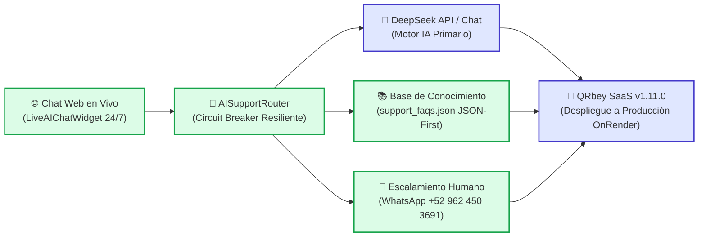

# Tablero de Control — QRgenerator (QRbey)

**Coordinador:** `pmAgent` & Equipo Técnico `DevTeam`  
**Versión Actual:** `v1.11.0`  
**Última Actualización:** 13 de Noviembre de 2026  
**Estado General:** 🟢 Soporte Omnicanal 24/7 con IA (DeepSeek & Circuit Breaker Resiliente), Widget de Chat Flotante Universal y Atención Directa por WhatsApp (+52 962 450 3691) v1.11.0 (45/45 Pruebas QA Aprobadas al 100%)

---

## 1. Diagrama de Estado del Proyecto

---

## 2. Matriz de Tareas y Entregables por Agente

| Agente | Responsabilidad | Estado | Entregable / Archivo |
| :--- | :--- | :--- | :--- |
| `pmAgent` | Gestión, priorización, plan de soporte omnicanal y control de versiones v1.11.0 | 🟢 Completado | `PLAN_IMPLEMENTACION_SOPORTE_OMNICANAL_24_7.md`, `CHANGELOG_QRGENERATOR.md` |
| `supportAgent` | Flujos de soporte, prompts de DeepSeek, FAQs y generador dinámico de WhatsApp | 🟢 Completado | `services/AISupportRouter.js`, `public/cache/support_faqs.json` |
| `frontAgent` | Widget interactivo flotante de chat 24/7 y carga universal en todas las páginas | 🟢 Completado | `public/js/components/LiveAIChatWidget.js`, `public/js/nav-auth.js` |
| `iconAgent` | Iconografía contextual para el widget (robot, chat, WhatsApp, send, minimize) | 🟢 Completado | Integración FontAwesome y badges dinámicos |
| `backendAgent` | Endpoints de chat (`/api/support/chat`), rate limiting y almacenamiento de sesiones | 🟢 Completado | `routes/supportRoutes.js`, `controllers/SupportController.js` |
| `securityAgent` | Filtro anti-prompt-injection, rate limiting por IP y custodia de secretos | 🟢 Completado | `AISupportRouter.checkPromptInjection`, `chatLimiter` |
| `cacheBdAgent` | Base de conocimiento JSON-First desacoplada sin sobrecarga a la base de datos | 🟢 Completado | `public/cache/support_faqs.json` |
| `bdAgent` | Bitácora de conversaciones y tickets de soporte | 🟢 Completado | `storage/support_conversations.json` |
| `devOpsAgent` | Variables de entorno (`WHATSAPP_SUPPORT_PHONE`, `DEEPSEEK_API_KEY`) y CI/CD | 🟢 Completado | `config/env.js`, `.env.example`, Render deployment |
| `qaAgent` | Suite de 45 pruebas rigurosas automatizadas (100% aprobadas) | 🟢 Certificado | `test/qa_omnichannel_support.js` (9/9 OK), `test/qa_suite.js` (45/45 OK) |
