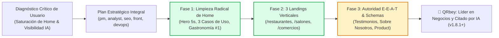

# Tablero de Control — QRgenerator (QRbey)

**Coordinador:** `pmAgent` & Equipo Técnico `DevTeam`  
**Versión Actual:** `v1.8.1`  
**Última Actualización:** 12 de Noviembre de 2026  
**Estado General:** 🟢 Fase 2 del Plan Estratégico de Transformación Completada (31/31 Pruebas QA Aprobadas al 100%)

---

## 1. Diagrama de Estado del Proyecto

---

## 2. Matriz de Tareas y Entregables por Agente

| Agente | Responsabilidad | Estado | Entregable / Archivo |
| :--- | :--- | :--- | :--- |
| `pmAgent` | Gestión, priorización, plan estratégico y control de versiones v1.8.1 | 🟢 Completado | `PLAN_ESTRATEGICO_TRANSFORMACION_QRBEY.md`, `CHANGELOG_QRGENERATOR.md` |
| `analystAgent` | Gap Analysis vs Competidores (Bitly, Flowcode, Uniqode) y propuesta de 5s | 🟢 Completado | Matriz estratégica y diferenciación comercial |
| `seoAgent` | Estrategia SEO/GEO, 3 landings verticales, JSON-LD Schemas, Answer-First y Sitemap | 🟢 Certificado | `/restaurantes`, `/salones-belleza`, `/comercios`, `robots.txt`, `sitemap.xml` |
| `frontAgent` | Landings verticales, Hero Banner interactivo, deep-linking y footer | 🟢 Completado | `restaurantes.html`, `salones-belleza.html`, `comercios.html`, `app.js` |
| `qrAgent` | Reorganización de categorías (Gastronomía, Compras, Belleza) y limpieza de textos | 🟢 Completado | `DesignLibrary.js`, `CanvasGenerator.js`, `QRPreview.js` |
| `backendAgent` | Ruteo Express para landings, defaults de generación y endpoints API REST | 🟢 Completado | `server.js`, `CanvasGenerator.js`, `QRController.js` |
| `paymentAgent` | Pasarela de pagos Recurrente oficial QRbey (Sandbox DEV, Webhooks en PROD) | 🟢 Certificado | `services/PaymentService.js`, `controllers/PaymentController.js` |
| `securityAgent` | Protección Helmet, rate limiting y aislamiento estricto de secretos API | 🟢 Completado | `server.js` (Helmet + express-rate-limit) |
| `filesAgent` | Gestión de almacenamiento y persistencia GCS | 🟢 Completado | `services/GCSService.js`, persistencia en nube |
| `cacheBdAgent` | Cabeceras de caché HTTP y desacoplamiento TiDB Cloud | 🟢 Completado | `controllers/QRController.js` (Cache-Control) |
| `devOpsAgent` | Anti-sleep UptimeRobot y CI/CD OnRender | 🟢 Completado | `controllers/HealthController.js`, `scripts/devops_render_deploy.js` |
| `qaAgent` | Suite de pruebas de regresión y calidad rigurosa (31/31 aprobadas) | 🟢 Certificado | `test/qa_suite.js` (31/31 Pasadas, 100% OK) |
